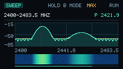
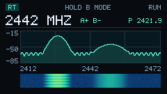
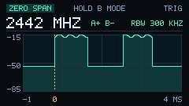
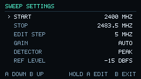
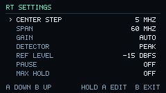
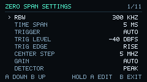

# Stick Spectrum

给 **M5Stack StickS3（K150）** 的独立频谱仪固件。使用板载 ESP32-S3 射频收发器、屏幕和按键；不需要外置 SDR、串口数据链路或电脑。频谱来自射频基带的原始 I/Q，而不是 Wi-Fi RSSI、CSI 或 AP 列表。

  

  

## 操作

| 按键 | `SWEEP` 主界面 | `RT` / `ZERO SPAN` 主界面 | 设置浏览 / 编辑 |
| --- | --- | --- | --- |
| A（正面）短按 | 暂停／继续 | 提高中心频率 | 下移 / 增大 |
| B（侧面）短按 | 切换 `MAX` 峰值保持 | 降低中心频率 | 上移 / 减小 |
| A 长按 | 打开设置 | 打开设置 | 开始编辑 / 确认 |
| B 长按 | 切换模式 | 切换模式 | 退出设置 / 取消本项编辑 |

主界面长按 B 按 `SWEEP → RT → ZERO SPAN` 循环切换。设置页打开时只有浏览光标，长按 A 后才进入编辑。

青线是当前曲线，金线是峰值保持。`SWEEP` 和 `RT` 下方显示瀑布图，`P` 是本帧最强频点（MHz）。

- `SWEEP` 的 `START`／`STOP` 可在 1850–2750 MHz 之间设定，最小跨度为 10 MHz。`EDIT STEP` 是按键每次修改起止频率的步长（0.5／1／5／10／25／50／100 MHz），不是内部扫频间隔。主界面顶部显示当前起止范围，只采集有用的扫频段。
- `RT` 和 `ZERO SPAN` 都能在主界面用 A+／B− 调中心频率，默认每次 5 MHz。设置页可改 `CENTER STEP`，暂停时调到新频率会恢复采集。
- `RT` 的 `SPAN` 设定 FFT 的显示跨度。`ZERO SPAN` 的 `RBW` 设定测量滤波带宽，`TIME SPAN` 设定横轴时长。两个模式均有 `PAUSE` 和 `MAX HOLD`。
- 三个模式各自保存本次开机期间的设置，包括增益、`PEAK`／`AVG` 检波和参考电平。重启恢复默认。

### ZERO SPAN 触发

| `TRIGGER` | 行为 |
| --- | --- |
| `FREE` | 自由运行，每帧刷新。开机默认。 |
| `AUTO` | 优先显示触发帧。约 250 ms 内没有新波形时，允许下一帧自由刷新。 |
| `NORMAL` | 等待符合条件的边沿，等待期间保留上一帧。 |
| `SINGLE` | 捕获一帧后显示 `HOLD`。在设置页选 `REARM` 并长按 A，再退出设置即可重新等待。 |

`TRIG LEVEL` 可在 −100～0 dBFS 间以 2 dB 步进设置，默认 −40 dBFS。`TRIG EDGE` 可选 `RISE`（上升沿）或 `FALL`（下降沿），默认上升沿。触发帧的金色虚线和横轴 `0` 标出触发位置，左侧保留 20% 时长。

## 三种模式

| 模式 | 显示范围 | 工作方式 |
| --- | --- | --- |
| `SWEEP`（开机默认） | 默认 2400–2483.5 MHz；可设到 **1850–2750 MHz** | 每 10 MHz 取一段重叠频谱；默认频段使用 8 个 LO 位置。避开每段的直流区和边缘，每个屏幕列取有效 FFT bin 中的最大值。 |
| `RT` | 固定中心，12 / 32 / **60 MHz** 显示跨度 | 固定 LO。采样率分别为 16 / 40 / 80 MS/s，使用 1024 点复数 Hann FFT。 |
| `ZERO SPAN` | 100 / 250 / 500 / 800 µs 和 1 / 2 / 5 / 10 / 20 ms，RBW 30 / 100 / 300 kHz / 1 / 3 MHz | 固定中心，显示 RBW 滤波后功率随时间的变化。默认 800 µs、300 kHz。 |

### 测量限制

- `RT` 和 `ZERO SPAN` 的中心频率分别设置，默认都是 2442 MHz，可调范围为 1850–2750 MHz。`RT` 每轮约 42 ms，使用 ESP-SDR 的三块 RF SRAM 轮转，并检查轮内的样本边界。CPU 忙时会跳过部分 FFT 窗口，轮次之间会暂停采集以刷屏和处理按键。PHY 校准失效时会重建同频的接收配置。
- `ZERO SPAN` 以 16 MS/s 采集独立的 I/Q 快照。4 MHz 低中频经数字混频移到基带，四阶 Butterworth 滤波器提供标称双边 −3 dB RBW。每帧预留 200 µs 让滤波器建立，再按时间列进行峰值或平均功率检波。毫秒档使用 RF SRAM 轮转与 GDMA 将每帧连续样本写入板载 PSRAM。帧间的处理与刷屏会留下采集间隙，20 ms 档一帧的采集和处理实测约需 0.36～0.38 秒，窄 RBW 也会展宽短脉冲。
- 触发在检波降采样前检查 RBW 滤波后的功率，采用 2 dB 滞回。只接受能凑齐整帧前后样本的边沿，单个脉冲有可能落到帧间或触发搜索窗口外。AUTO 超时按采集帧检查，长时基下自由刷新间隔可超过 250 ms。
- 80 MS/s 是复采样率，不等于 80 MHz 的平坦带宽；ESP-SDR 测得 S3 最宽模拟滤波约 69 MHz。60 MHz 是显示跨度，不是性能保证；滤波滚降和混叠均可能影响结果。中心附近抑制直流，对正好落在 LO 上的信号，可把中心移开 1 MHz 后复查。
- 扩展扫频范围来自 ESP-SDR 在另一块 ESP32-S3 板上的离散测试点，并非 StickS3 实测。芯片低频段借助 5/6 LO 分频；板载 2.4 GHz 天线和匹配网络在带外可能大幅衰减。没有可靠 PLL 锁定读数，噪声、镜像或杂散不能证明调谐成功；不支持 5 GHz。
- 纵轴是 ADC 相对电平（近似 dBFS），不是校准过的天线端 dBm。`AUTO` 的增益可能改变，扫频各段也并非同时测量；比较电平可选同一个手动增益，遇到强信号或杂散可尝试降低增益。不连接 Wi-Fi、不运行发包功能，但不能保证 PHY 启动或后台校准不产生射频发射。

## 编译和烧录

射频后端用到了 ESP32-S3 的私有 PHY 调用和内存布局。**建议用 ESP-SDR 固件清单中锁定的 ESP-IDF 提交**，不要任意换版本。无额外 IDF 组件依赖。

```sh
# 仅首次安装。把 ESP-IDF 放在固件仓库之外。
git init "$HOME/esp-idf-stick"
git -C "$HOME/esp-idf-stick" remote add origin https://github.com/espressif/esp-idf.git
git -C "$HOME/esp-idf-stick" fetch --depth 1 origin 25fe69f946311abdaf9ad56591f25fedbc20ac98
git -C "$HOME/esp-idf-stick" checkout --detach FETCH_HEAD
git -C "$HOME/esp-idf-stick" submodule update --init --recursive
(cd "$HOME/esp-idf-stick" && ./install.sh esp32s3)
. "$HOME/esp-idf-stick/export.sh"

# 在本仓库内执行。
idf.py -B build -DSDKCONFIG=build/sdkconfig build
```

从旧版更新时，用新的构建目录生成配置，使 `sdkconfig.defaults` 中的 PSRAM 设置生效。

烧录会覆盖现有的引导程序、分区表和应用。若想保留 UiFlow2 及其板上数据，先做整片备份（备份含设备数据，不要公开上传）。ESP32-S3 下载模式：长按复位键约 2 秒直到绿灯亮，再松手；随后等绿灯熄灭后连接 USB 并查看新出现的串口，macOS 通常是 `/dev/cu.usbmodem*`，Linux 通常是 `/dev/ttyACM*`。不要用普通 UiFlow2 运行模式的端口名推断下载模式端口。

```sh
PORT=/dev/cu.usbmodemXXXX  # 替换成实际的下载模式端口
python -m esptool --chip esp32s3 -p "$PORT" read-flash 0x0 0x800000 "$HOME/sticks3-original.bin"
idf.py -B build -p "$PORT" flash monitor
```

若要从备份恢复，重新进入下载模式并运行 `python -m esptool --chip esp32s3 -p "$PORT" write-flash 0x0 "$HOME/sticks3-original.bin"`。无需为本固件执行 `erase-flash`。

## 验证

使用本机 ESP-IDF 5.5.4 交叉编译。锁定的上游 SDK 构建及真机射频标定尚未完成。

- `./tests/run.sh` 覆盖扫频拼接、频率限位和 FFT 映射，也用合成 I/Q 测试 `ZERO SPAN` 的 RBW 响应、脉冲曲线、峰值检波、上升／下降沿、触发对齐和 AUTO 回退。
- StickS3 串口诊断已确认 2442 MHz、800 µs 下五档 RBW 均能采集并输出功率。300 kHz RBW 下九档时基均通过自由运行与触发采集，最长记录也通过样本连续性检查。RBW、电平及射频触发精度尚未用已知信号源标定。
- LCD 初始化按 M5GFX 设置 `LCMCTRL=0x0C`、`MADCTL.BGR` 和 `INVON`，以免复位默认的 `XBGR` 把红蓝对调。SPI 像素使用高字节先行的 RGB565。

## 来源与许可

本项目按 **GPL-3.0-or-later** 发布，见 `LICENSE`。`main/esp_sdr` 来自 [ESPARGOS/esp-sdr](https://github.com/ESPARGOS/esp-sdr/tree/3ab3b65bb62f2d9427ee33c2c3b627427e729294)，保留 S3 调谐、校准及 SRAM 轮转／SIMD FFT，改为直接返回线性功率数组并移除串口协议及流式 I/Q 输出。其中 FFT 内核源自 Espressif ESP-DSP，采用 Apache-2.0，见 `main/esp_sdr/LICENSE.esp-dsp`。硬件引脚及屏幕映射参考 [M5Stack StickS3 文档](https://docs.m5stack.com/en/core/StickS3)、[M5GFX](https://github.com/m5stack/M5GFX) 与 [M5Unified](https://github.com/m5stack/M5Unified)。
